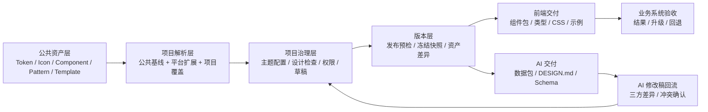

# 设计规范管理平台产品规划说明书 V1.0

> 更新时间：2026-09-23
> 产品名称：设计规范管理平台（Design Intelligence System）
> 文档状态：规划基线
> 参考结构：[DocuNexus 产品规划说明书 V5.0](https://zhipu-ai.feishu.cn/docx/ISXjdfgHpoKHddxddJIcblqKnTd)
> 事实口径：以当前仓库、`PRODUCT.md`、`DESIGN.md`、`system.manifest.json`、运行时注册表和交付文档为准。

## 0. 文档目的

本文用于统一回答五个问题：产品是什么、解决什么问题、谁来使用、核心流程如何闭环、下一阶段如何推进和验收。

本文不是页面需求明细，也不把规划能力写成已上线能力。所有能力按以下状态标记：

- **已实现**：当前代码中存在可用入口或可执行流程，并已有相应验证记录。
- **候选可用**：本地闭环已形成，但仍需在真实业务工程或真实部署环境中验收。
- **原型验证**：已有界面或规则演示，不代表真实服务已经接通。
- **规划中**：需要新增产品、工程或外部集成能力。
- **不在本期**：当前阶段明确不承诺。

---

## 1. 产品是什么

### 1.1 产品定位

设计规范管理平台是一套面向企业多项目、多角色和多交付对象的**设计资产治理与交付平台**。

它把分散在设计稿、Markdown、代码、组件文档和个人经验中的设计规则，沉淀为可查找、可配置、可冻结、可交付、可验收的数字资产，并让设计师、产品经理、前端开发者和未来的 AI 工具在同一项目与版本上下文中协作。

平台的核心不是“多放一些组件”，而是建立一条完整链路：

> 资产进得来 → 规则可解析 → 项目能配置 → 版本可冻结 → 前端与 AI 可消费 → 业务系统能验收 → 结果可追溯

### 1.2 产品形态

平台由三类操作界面和一套共享资产底座组成：

1. **公共资产中心**：浏览通用设计基础、组件、交互模式和页面模板。
2. **项目治理工作台**：配置项目主题，管理项目资产、成员、设计检查和版本。
3. **交付与验收中心**：向前端或 AI 输出绑定项目版本的规范数据与组件包，并登记真实业务验收。
4. **共享资产底座**：统一保存 Token、组件契约、Pattern、Template、图标、Runtime 身份和版本快照。

### 1.3 产品不是什么

- 不是只展示截图和代码片段的静态组件文档站。
- 不是让所有项目共用同一套视觉皮肤或同一套组件代码。
- 不是自由拖拽搭建任意页面的低代码平台。
- 不是已经接入真实模型的通用聊天机器人。
- 不是 Figma、Storybook 或业务前端工程的替代品。

---

## 2. 要解决的问题

### 2.1 核心问题

企业的设计规范经常“存在”，但没有形成一条能持续被项目、开发和 AI 正确消费的链路。

这会形成五层递进问题：

> 规范分散 → 项目难适配 → 版本难锁定 → 交付难落地 → 结果难验收

### 2.2 痛点一：设计规则分散，查得到但复用不了

- Token、组件状态、交互规则、页面结构和使用示例分布在 Figma、文档、代码与个人经验中。
- 同一概念在不同材料中命名不一致，前端无法判断哪份是当前有效规则。
- 组件“有页面”不等于有完整 API、状态、可访问性、示例和运行时实现。

**影响**：每次做页面仍要重新对齐，设计规范成为参考资料，而不是生产资料。

### 2.3 痛点二：通用规范与项目差异容易混在一起

- 企业需要公共基线，但不同项目具有不同品牌、密度、业务规则和组件准入范围。
- 直接复制组件会形成多个不可同步的分支；强迫所有系统共用代码又不符合现实。
- 草稿和历史版本若没有显式上下文，查阅旧版本时容易误用当前配置。

**影响**：规范越扩张，项目之间的差异和维护成本越难控制。

### 2.4 痛点三：发布不等于可交付

- 只有 Token 或规范快照，不代表前端拿到了匹配的可执行组件。
- 组件包、文档、类型声明、运行时身份和项目版本不一致时，接入结果不可复现。
- 交付后没有业务验收记录，平台无法知道某版本是否真的在目标系统中可用。

**影响**：团队容易把“平台内看起来正确”误判为“业务系统已经落地”。

### 2.5 痛点四：AI 缺少结构化、版本化的设计上下文

- 单独给 AI 一份 `DESIGN.md`，不能保证它知道可用组件、必填属性、状态、图标和模板数据契约。
- AI 修改后的规范若直接覆盖当前内容，可能回退人工已经更新的 Token，或错误改写历史版本。
- 没有项目和版本身份，生成结果无法证明使用了哪套规则。

**影响**：AI 可以生成界面，但难以稳定遵守企业已有设计系统。

### 2.6 痛点五：治理动作缺乏权限、审计和恢复能力

- 项目、成员、发布、删除、主题保存和验收都具有不同风险等级。
- 只在前端隐藏按钮不能形成真实权限边界。
- 多人同时编辑若没有修订冲突保护，容易覆盖彼此工作。

**影响**：平台可以演示，却无法安全进入团队日常工作。

### 2.7 我们的解法

用共享资产模型承接通用规范，用项目上下文承接差异，用冻结版本承接历史，用两类交付物分别服务前端与 AI，再用业务验收记录完成闭环。

```text
公共设计资产
  ├─ Token / Icon / Component / Pattern / Template
  ↓ 项目继承与覆盖
项目草稿
  ├─ 主题与密度
  ├─ 项目准入组件
  └─ 特殊业务规则
  ↓ 检查、预检、发布
冻结版本
  ├─ AI 规范数据包 + DESIGN.md
  └─ 匹配 Runtime 的可执行组件包
  ↓ 真实业务工程接入
业务验收
  ├─ 负责人 / 系统 / 检查项
  └─ 升级、失败、回退记录
```

---

## 3. 能做什么

### 3.1 当前能力概览

| 能力域 | 当前能力 | 状态 |
|---|---|---|
| 公共资产 | 查阅设计基础、组件、交互模式、页面模板和图标资源 | 已实现 |
| 项目管理 | 新增项目、项目列表、项目概览、项目隔离 | 已实现 |
| 主题配置 | 配置颜色、字体、字号、圆角、边框、阴影、间距与密度 | 已实现 |
| 组件治理 | 国科信项目当前准入 76 个组件，其中 62 个通用组件、14 个 AI 交互组件；React Aria 54 个基础家族已全部覆盖 | 已实现 |
| 交互模式 | 12 个可复用模式，覆盖筛选、表格、批量操作、错误恢复等常见流程 | 已实现 |
| 页面模板 | 4 类结构化模板，使用 `page-template/1` 数据契约 | 已实现 |
| 设计检查 | 检查当前版本对比度、未知 Token 和 DS 组件引用 | 已实现，本地确定性规则 |
| 版本治理 | 草稿、冻结版本、版本切换、资产差异和不可变历史上下文 | 已实现 |
| 发布预检 | 区分“规范数据快照”和“可执行组件交付” | 已实现 |
| 前端交付 | 生成绑定项目与版本的本地组件包、类型、样式和接入说明 | 候选可用 |
| AI 交付 | 输出固定读取顺序的规范数据包与项目 `DESIGN.md` | 候选可用 |
| AI 修改回流 | 校验身份并执行“来源冻结版 → AI 修改稿 → 当前草稿”三方差异 | 已实现，限白名单主题 Token |
| 业务验收 | 登记消费系统、负责人、状态、检查项、升级与回退信息 | 已实现 |
| 团队治理 | 账号会话、平台管理员、查看者/编辑者/项目管理员、邀请、审计与冲突保护 | 已实现，本地工作区 |
| 公开演示 | GitHub Pages 无登录只读演示 | 已实现，写操作不可用 |
| 智能助手 | 根据本地规则推荐模式与资产 | 原型验证，未接真实模型且未进入正式主流程 |
| Figma 同步 | 已准备交接数据和映射基础 | 规划中，目标文件与绑定未提供 |
| 远端协作 | 本地 Node/SQLite 闭环已具备 | 规划中，待部署、SSO、邮件和运维体系 |

### 3.2 核心输出物

平台不只输出页面，还输出六类可持续消费的资产：

1. **设计规范**：公共原则、项目 `DESIGN.md`、使用边界和可访问性规则。
2. **结构化资产**：Token、组件、图标、Pattern、Template、布局与区域外观数据。
3. **可执行组件**：绑定项目与冻结版本的 React 组件包、样式和类型声明。
4. **版本证据**：冻结快照、资产差异、Runtime 身份、校验结果和发布说明。
5. **接入材料**：安装命令、主题接入示例、升级与回退说明。
6. **验收记录**：消费系统、负责人、验收项、结果和后续动作。

### 3.3 能力边界

当前明确不把以下内容写成已具备能力：

- 不声称已经连接真实 OpenAI、MCP、Figma API、公司 SSO 或邮件网关。
- 不声称本地确定性规则检查等于完整 AI 设计评审。
- 不承诺一套 React 组件代码直接覆盖 Vue、移动端、嵌入式或空间计算平台。
- 不允许修改冻结历史版本；AI 修改稿只可进入当前草稿。
- 不把没有匹配 Runtime 归档的版本包装为可执行组件交付。
- 不把公开演示站当成可写入的团队工作区。
- 不在本期建设自由拖拽页面编辑器和完整业务系统导出。

---

## 4. 核心价值

### 4.1 价值定位

平台的核心价值是让企业设计规则从“被人阅读的说明”升级为“可被项目、代码和 AI 共同消费的版本化资产”，并让一次设计系统建设持续服务多个业务系统。

### 4.2 价值一：形成设计资产的单一可信来源

- 组件身份、Token、状态、绑定和示例由同一组结构化数据关联。
- 公共基线、项目覆盖和冻结版本拥有清晰来源。
- 设计结果可以追溯到具体项目、版本和 Runtime。

### 4.3 价值二：减少项目重复建设和规则漂移

- 项目继承公共实现，只保存必要覆盖，不复制整套组件。
- Pattern 和 Template 复用用户可见的行为、术语和状态合同。
- 跨技术栈时统一体验与验收标准，不强制统一代码库。

### 4.4 价值三：把设计系统变成可交付工程能力

- 发布前检查可执行条件，交付物与版本绑定。
- 前端拿到的不只是视觉说明，还包括组件、类型、样式和接入方法。
- 交付后回到平台登记业务验收，支持升级和回退决策。

### 4.5 价值四：为 AI 提供受治理的设计上下文

- AI 按固定顺序读取结构化规范，不依赖模糊提示词猜测。
- 可用组件、属性、状态、图标和模板均受项目版本约束。
- AI 修改需要经过差异、冲突和人工确认，不能静默改写正式资产。

### 4.6 价值五：建立长期治理与审计能力

- 权限由服务端逐请求核验。
- 发布、验收、成员和项目操作可记录、可回溯。
- 草稿冲突、错误恢复和危险操作有明确产品规则。

---

## 5. 面向用户

### 5.1 核心用户

#### 1. 产品经理与设计师

- **任务**：确定项目视觉方向、查找组件与模式、配置主题、检查规范、准备发布。
- **障碍**：规范分散，难确认当前项目应该使用哪套规则；设计稿与实现容易漂移。
- **产品价值**：从公共资产出发完成项目化配置，并以冻结版本交付，不再依靠口头同步。

#### 2. 前端开发者

- **任务**：确认可用组件与 API、安装项目组件包、实现页面、处理状态与响应式规则。
- **障碍**：文档、代码和版本经常不一致；缺少完整状态与业务回调说明。
- **产品价值**：获得版本匹配的组件、类型、Token、模板契约和接入说明，并可明确发现缺口。

#### 3. 项目管理员与平台管理员

- **任务**：创建项目、分配成员权限、发布版本、查看审计、管理高风险操作。
- **障碍**：跨项目资产与权限边界不清，错误修改影响范围难追踪。
- **产品价值**：用项目隔离、角色权限、修订冲突和审计记录控制治理风险。

#### 4. 业务系统负责人 / 验收人

- **任务**：确认组件包在真实业务系统中的主流程、异常、可访问性、升级和回退表现。
- **障碍**：平台发布状态与业务真实可用状态脱节。
- **产品价值**：在版本页留下明确的接入与验收结论，使后续升级有据可依。

#### 5. AI / Codex 等智能消费方

- **任务**：基于项目规范生成或检查页面，并输出可复核的实现。
- **障碍**：上下文不完整、版本不明确、组件 API 被臆造、修改难安全回流。
- **产品价值**：读取版本化数据包和组件合同，在白名单与确认门内完成生成和改稿。

### 5.2 服务边界

- 平台首先服务“设计资产治理与交付”，不承担业务系统本身的需求管理。
- 设计师决定体验意图与规则；平台负责结构化、版本化与交付，不替代设计决策。
- 前端组件包提供基础能力和合同，业务数据、接口、权限和业务回调仍由消费工程负责。
- AI 提供建议或修改稿，正式发布始终需要有权限的人员确认。

---

## 6. 产品方案

### 6.1 整体架构



### 6.2 三类界面职责

#### 界面 A：公共资产中心（查阅式 · 高频检索）

- **给谁**：产品经理、设计师、前端开发者。
- **职责**：查找公共设计基础、组件、交互模式和页面模板；查看语义、规则、状态、示例和取用方法。
- **原则**：公共资源固定使用通用基线，不受项目缓存和主题覆盖影响。
- **当前入口**：`/assets`、`/components`、`/patterns`、`/templates`、`/search`。

#### 界面 B：项目治理工作台（配置式 · 低频高风险）

- **给谁**：设计师、项目管理员、平台管理员。
- **职责**：管理项目主题、项目组件与模板、设计检查、成员权限、版本和发布预检。
- **原则**：草稿可编辑、冻结版只读；所有项目页面保持 `projectId + version` 上下文。
- **当前入口**：`/projects/:projectId/*`。

#### 界面 C：交付与验收中心（执行式 · 版本驱动）

- **给谁**：前端开发者、AI 使用者、业务系统负责人。
- **职责**：下载规范数据或组件包、阅读接入说明、完成业务工程验证、登记验收与回退结果。
- **原则**：规范数据和可执行组件包是独立状态；没有匹配 Runtime 时只交付规范快照。
- **当前入口**：项目“版本记录”页面。

### 6.3 三类界面的协同关系

| 任务 | 主界面 | 产物去向 |
|---|---|---|
| 查找通用组件或模式 | 公共资产中心 | 带入项目或业务实现 |
| 配置项目品牌与密度 | 项目治理工作台 | 写入当前项目草稿 |
| 检查并发布版本 | 项目治理工作台 | 生成不可变冻结快照 |
| 安装组件包 | 交付与验收中心 | 进入指定业务工程 |
| 将规范交给 AI | 交付与验收中心 | 进入指定 AI 任务 |
| 导入 AI 修改稿 | 交付与验收中心 → 项目治理工作台 | 经三方差异写回草稿 |
| 登记真实接入结果 | 交付与验收中心 | 形成版本验收记录 |

三类界面不是三套独立系统，而是同一套资产、项目和版本数据的不同操作窗口。

### 6.4 四个关键产品机制

#### 1. 项目与版本上下文锁定

项目资源链接必须保留 `projectId + version`。历史版本不能静默回落到当前草稿；无效版本需要明确失败并提供恢复路径。

#### 2. 发布前交付预检

发布前检查冻结快照与 Runtime 归档。满足条件时标记为“可执行交付”；不满足时只生成“规范数据快照”，不得制造不存在的组件包。

#### 3. AI 修改确认门

AI 修改稿只对当前草稿生效。系统先校验 schema、项目、来源版本和快照，再展示三方差异；冲突默认不选中，用户确认后才写入。

#### 4. 交付后验收闭环

发布完成不是终点。业务工程需验证安装、主流程、异常恢复、键盘操作、窄屏、升级和回退，并将结果登记到对应版本。

### 6.5 核心数据对象

| 对象 | 作用 | 关键约束 |
|---|---|---|
| Public Asset | 通用 Token、组件、Pattern、Template、Icon | 不受项目主题污染 |
| Project | 项目身份、平台、主题覆盖、特殊规则、组件准入 | 项目之间严格隔离 |
| Draft | 当前可编辑项目状态 | 有修订冲突保护 |
| Release | 不可变的项目版本 | 必须绑定项目与版本 |
| Runtime Archive | 与发布版本匹配的组件实现 | 身份不匹配则停止交付 |
| AI Bundle | 供 AI 读取的结构化规范 | 固定顺序、明确 schema |
| Delivery Acceptance | 真实业务接入与验收记录 | 绑定项目、版本与消费系统 |
| Membership / Audit | 项目角色和关键操作记录 | 服务端校验，不依赖前端隐藏 |

---

## 7. 典型应用场景

### 7.1 场景 A：查找并复用设计资产

- **用户**：产品经理、设计师、前端开发者。
- **诉求**：快速找到适合任务的组件、交互模式或页面模板。
- **主入口**：公共资产中心与全站搜索。
- **链路**：输入任务或关键词 → 查看资产语义与适用边界 → 查看状态和示例 → 复制用法或进入项目版本。
- **结果**：明确使用哪个资产、为什么使用、需要覆盖哪些状态。
- **状态**：已实现。

### 7.2 场景 B：建立项目主题与准入范围

- **用户**：设计师、项目管理员。
- **诉求**：在不复制公共组件的前提下形成项目视觉与业务差异。
- **主入口**：项目概览、设计规范、主题与风格、项目组件。
- **链路**：选择公共基线 → 配置项目 Token → 预览组件和页面 → 保存草稿 → 运行设计检查。
- **结果**：可追溯的项目主题、组件准入清单和特殊规则。
- **状态**：已实现。

### 7.3 场景 C：冻结并发布项目版本

- **用户**：项目管理员。
- **诉求**：把当前草稿发布成业务可引用的稳定版本。
- **主入口**：项目“版本记录”。
- **链路**：完成设计检查 → 执行 Runtime 预检 → 填写版本与说明 → 冻结快照 → 明确交付类型。
- **结果**：不可变版本；状态为“可执行交付”或“规范数据快照”。
- **状态**：已实现。

### 7.4 场景 D：前端接入真实业务工程

- **用户**：前端开发者、业务系统负责人。
- **诉求**：把指定项目版本接入真实页面，并可升级或回退。
- **主入口**：版本页“前端接入”。
- **链路**：选择冻结版本 → 下载匹配组件包 → 安装并锁定依赖 → 接入主题和组件 → 验证业务流程 → 登记验收。
- **结果**：可运行页面、锁定的组件版本和业务验收记录。
- **状态**：本地独立 Consumer 已验证；真实公司业务工程接入待完成。

### 7.5 场景 E：将设计规范交给 AI 生成页面

- **用户**：产品经理、设计师、前端开发者、AI 使用者。
- **诉求**：让 AI 使用正确项目、版本和组件合同生成页面。
- **主入口**：版本页“AI 规范数据”。
- **链路**：选择冻结版本 → 下载 AI 数据包与项目 `DESIGN.md` → 同时提供页面需求和组件包 → AI 实现 → 类型、构建和浏览器验收。
- **结果**：可追溯到项目版本的实现，不允许 AI 臆造未批准组件。
- **状态**：交付格式与独立消费验证已完成；真实模型质量评估待接入。

### 7.6 场景 F：AI 修改设计规范后安全回流

- **用户**：设计师、项目管理员。
- **诉求**：把 AI 优化后的设计 Markdown 合并回网站，同时保留人工后续修改。
- **主入口**：当前草稿的版本页。
- **链路**：上传或粘贴修改稿 → 校验身份 → 三方差异 → 处理冲突 → 写入白名单 Token → 在主题页复核 → 发布新版本。
- **结果**：只更新当前草稿，不改历史版本，不自动发布。
- **状态**：已实现，自动回流范围暂限主题 Token。

### 7.7 场景 G：多人协作与项目治理

- **用户**：平台管理员、项目管理员、查看者、编辑者。
- **诉求**：让不同角色安全参与项目，并避免并发覆盖。
- **主入口**：平台管理、项目成员与权限、项目编辑页。
- **链路**：创建项目 → 邀请成员 → 分配角色 → 编辑/查看/发布 → 记录审计 → 处理修订冲突。
- **结果**：项目级权限边界与可追溯变更。
- **状态**：本地工作区已实现；远端团队部署待完成。

### 7.8 场景的开放性

未来可以在不改变资产主模型的前提下扩展：Figma 双向同步、真实 AI 评审、跨技术栈适配包、自动回归报告和更多页面模板。新增能力必须继续遵守项目隔离、版本不可变、交付预检和人工确认边界。

---

## 8. 可复用资产与复用边界

### 8.1 可复用资产

| 资产层 | 主要内容 | 复用方式 |
|---|---|---|
| 原则层 | 语义优先、可访问性、状态完整、受控定制 | 所有项目共同遵守 |
| Token 层 | 颜色、排版、尺寸、圆角、边框、阴影、间距、密度 | 项目按语义覆盖 |
| 组件层 | React Aria 基础上的语义组件与 AI 交互组件 | React 工程直接消费；其他栈做适配 |
| 模式层 | 搜索筛选、表格管理、批量操作、错误恢复等 | 跨组件库统一行为与验收 |
| 模板层 | 列表、详情、表单等页面起点及数据合同 | 按业务字段和权限扩展 |
| 图标层 | 语义图标注册表与项目子集 | 按语义选择，不手绘替代 |
| 文档层 | `DESIGN.md`、API、组件矩阵、接入与回退说明 | 人、前端和 AI 共同读取 |
| 版本层 | 快照、差异、Runtime 身份与验收记录 | 支撑复现、升级和审计 |

### 8.2 复用边界规则

1. 公共组件实现只维护一份，项目通过 Token、准入和特殊规则形成差异。
2. 项目资产不能反向污染公共基线。
3. Frozen 版本只读取自己的 manifest 和快照，不读取当前草稿补齐缺失项。
4. Pattern 统一用户可见行为和状态，不要求所有业务系统共用组件代码。
5. React 组件包只承诺已验证的 React/React Aria 路径；其他技术栈先做 Token 与行为合同适配。
6. AI 规范数据不等于可执行代码；组件包不等于完整业务页面。
7. 所有外部接入必须记录目标、版本、负责人、验收和回退策略。

### 8.3 复用价值矩阵

| 资产 | 设计师 | 前端 | AI | 业务验收 |
|---|---|---|---|---|
| Token | 配置视觉语言 | 使用稳定变量 | 约束样式生成 | 核对品牌与状态 |
| Component | 复用交互与状态 | 使用 API 与类型 | 只调用批准组件 | 验证真实行为 |
| Pattern | 统一任务流程 | 组合业务组件 | 选择合适交互 | 核对流程完整性 |
| Template | 快速组织页面 | 接入数据与权限 | 生成结构起点 | 覆盖主流程与异常 |
| Release | 锁定设计决策 | 锁定依赖 | 锁定上下文 | 绑定验收结论 |

---

## 9. 产品路线图

### 9.1 当前基线：本地稳定候选（已完成）

**目标**：证明公共资产、项目配置、版本发布、前端/AI 交付和业务验收能够在本地形成闭环。

**现状**：核心流程已实现并有本地测试、构建和浏览器验证；这不是远端正式生产发布。

**退出条件**：已满足当前仓库声明范围，后续以真实项目试点结果作为新基线。

### 9.2 里程碑 M1：真实业务工程试点（最高优先级）

**目标**：选择一个真实业务系统，完成一次端到端组件接入和版本验收。

**前置输入**：目标工程仓库、技术栈、业务页面、接口/数据、权限模型、项目负责人和验收人。

**工作包**：

- 锁定项目与发布版本。
- 接入真实组件包、主题、业务数据和回调。
- 验证列表/详情/表单主流程及 loading、empty、error、disabled、permission 等状态。
- 验证键盘、对比度、窄屏和容器滚动。
- 演练升级与回退，并将结论登记到版本页。

**验收退出**：业务主流程通过；无版本漂移；高风险缺陷为 0；升级和回退均有记录。

**建议周期**：在输入完整、以一个 React Web 页面族为范围的前提下，2–3 周。

### 9.3 里程碑 M2：团队远端部署

**目标**：把本地工作区升级为可供团队持续使用的部署环境。

**前置输入**：服务器、域名、HTTPS、数据库策略、备份策略、账号体系和安全要求。

**工作包**：

- 部署前后端与数据库，建立环境配置和健康检查。
- 接入公司 SSO；补齐邮件邀请或采用明确的企业内分发方案。
- 建立备份、恢复、审计留存、监控和告警。
- 完成权限矩阵、安全测试和并发编辑验证。

**验收退出**：授权用户可稳定访问；越权请求被服务端拒绝；备份可恢复；审计和监控可用。

**建议周期**：3–5 周，取决于公司基础设施和 SSO 对接效率。

### 9.4 里程碑 M3：Figma 设计源接入

**目标**：让核心 Token、组件 Variant、状态和代码绑定在 Figma 与平台之间可核对。

**前置输入**：目标 Figma 团队/文件、库权限、变量策略和 Code Connect 目标。

**工作包**：

- 先验证 Button、Input、Select 组件族的变量与状态。
- 建立设计节点、代码组件和项目版本的绑定关系。
- 对差异执行预览和人工确认，不直接覆盖正式资产。
- 通过试点后扩展到项目准入组件。

**验收退出**：首批组件名称、属性、状态、变量和代码映射一致；双向差异可追溯；未绑定项明确显示。

**建议周期**：2–4 周完成首批试点，不含全量组件补绘时间。

### 9.5 里程碑 M4：真实 AI 设计协同

**目标**：验证 AI 在受治理上下文中完成生成、检查和规范修改的真实质量。

**前置输入**：模型/代理选择、数据发送范围、隐私要求、质量样本集和人工复核人。

**工作包**：

- 接入服务端代理，不在浏览器保存密钥。
- 建立提示、响应 schema、失败、取消、超时和重试机制。
- 用固定页面任务集评估组件调用正确率、Token 合规率、状态覆盖和一次通过率。
- 保留人工确认门；AI 不直接发布、不静默修改正式版本。

**验收退出**：数据范围审批完成；错误和超时可恢复；质量指标达到试点阈值；所有写入可追溯和回滚。

**建议周期**：2–4 周完成单模型试点，模型横向评测另行排期。

### 9.6 里程碑 M5：规模化治理

**目标**：从单项目验证扩展到多团队、多技术栈和持续升级。

**工作包**：版本弃用策略、跨项目影响分析、组件采用率、异常趋势、Vue/其他栈适配、自动回归报告、项目模板化创建。

**验收退出**：每个消费系统可追溯到明确版本；重大升级有影响清单；例外有责任人与到期时间。

---

## 10. 客户 / 业务系统接入清单

### 10.1 接入前必须提供

- 目标系统名称、仓库和技术栈。
- 需要接入的页面与关键任务流程。
- 业务数据结构、接口、权限和回调约定。
- 当前设计稿、历史规范和已有组件库情况。
- 目标项目、冻结版本、组件范围和图标范围。
- 验收负责人、上线窗口、升级和回退策略。

### 10.2 平台侧交付

- 绑定项目/版本的 `DESIGN.md` 与 AI 规范数据包。
- 条件满足时提供匹配的组件包、CSS、类型与安装说明。
- 组件、Pattern、Template 和状态清单。
- 版本差异、已知限制、升级与回退说明。
- 业务验收记录入口。

### 10.3 消费方负责

- 真实业务数据、接口、鉴权和权限控制。
- 业务回调、路由、日志、监控和异常处理。
- 在目标浏览器、屏幕尺寸和辅助技术环境中验收。
- 锁定依赖版本，并在升级前完成回归和回退演练。

---

## 11. 指标与验收口径

### 11.1 北极星指标

**被真实业务系统验收通过、且可追溯到明确项目与版本的设计系统交付次数。**

该指标强调“真实消费 + 版本绑定 + 验收完成”，避免用组件数量或页面访问量冒充产品价值。

### 11.2 建议指标

| 维度 | 指标 | 建议口径 |
|---|---|---|
| 资产质量 | 项目准入组件合同完整率 | React Binding、Token、状态、Storybook 入口均存在 |
| 版本可靠性 | 历史版本错误回落次数 | 目标为 0 |
| 交付可靠性 | 组件包与 Runtime 身份不匹配后仍继续交付的次数 | 目标为 0 |
| 接入效率 | 从锁定版本到首个真实页面通过验收的周期 | 以试点建立基线后优化 |
| 体验一致性 | 关键 Pattern 状态覆盖率 | 覆盖默认、加载、空、错误、权限与恢复路径 |
| 可访问性 | 阻断级键盘/对比度问题 | 发布验收目标为 0 |
| AI 合规 | AI 生成结果的批准组件调用正确率 | 接真实模型后建立基线 |
| 治理 | 发布版本拥有业务验收记录的比例 | 进入生产使用的版本目标为 100% |
| 升级安全 | 重大版本具备回退记录的比例 | 目标为 100% |

### 11.3 统一验收原则

- 不以组件“能挂载”代替交互行为验证。
- 不以 URL 变化代替页面内容加载成功。
- 不以平台预览代替真实业务工程验收。
- 不以规范快照代替可执行组件交付。
- 不以本地规则检查代替真实 AI 评审或人工设计验收。
- 不把未连接的 Figma、AI、SSO、邮件和远端部署写成已上线。

---

## 12. 风险与待决策项

### 12.1 主要风险

1. **真实接入不足**：长期只在平台和 Consumer 样例中验证，会高估可交付性。
2. **版本资产不完整**：没有匹配 Runtime 的历史版本只能作为规范快照使用。
3. **组件范围膨胀**：新增组件若没有状态、Token、Binding 和验收证据，会降低整体可信度。
4. **AI 越界修改**：扩大自动回流范围前，必须先建立字段级 schema、差异和回滚机制。
5. **跨技术栈误解**：Vue/其他组件库项目需要适配，不应宣称直接复用 React 代码。
6. **外部依赖阻塞**：Figma、SSO、邮件和真实 AI 都需要目标系统、权限与安全审批。

### 12.2 需要优先确认的决策

1. 首个真实业务接入项目是哪一个，负责人和验收人是谁？
2. 下一阶段优先级是“真实前端接入”“团队部署”“Figma”还是“真实 AI”？
3. 项目组件包最终通过本地包、私有 npm 还是内部制品平台分发？
4. 远端工作区采用现有 SQLite 过渡，还是直接迁移到企业数据库？
5. AI 可以接收哪些设计和业务数据，是否允许发送到外部模型？
6. Figma 以代码为准、以设计文件为准，还是采用差异确认后的双向治理？

---

## 13. 近期执行建议

下一步不建议同时展开所有外部能力。优先完成一个真实业务工程的组件交付与验收，因为它能最早验证平台的核心价值，也能暴露文档、组件合同、版本和回退链路中的真实缺口。

建议顺序：

1. 确定一个 React Web 业务页面族作为试点。
2. 锁定项目、冻结版本、组件范围、负责人和验收标准。
3. 完成真实接入、浏览器验证、升级/回退和版本页验收记录。
4. 依据试点结果决定先建设远端协作、Figma 还是 AI 服务。
5. 将验证后的流程模板化，再扩展到更多项目和技术栈。

---

## 14. 事实来源

- 产品边界与用户：`PRODUCT.md`
- 视觉原则与组件规则：`DESIGN.md`
- 项目与路由：`src/app/App.tsx`
- 国科信准入组件：`system.manifest.json`、`docs/COMPONENT-MATRIX.md`
- 当前进度与验收：`docs/PROJECT-PLAN.md`
- AI 规范交付与回流：`docs/AI-DESIGN-MD.md`
- 前端交付：`docs/FRONTEND-DELIVERY.md`、`docs/PROJECT-DELIVERY-IMPLEMENTATION.md`
- 外部能力边界：`docs/EXTERNAL-INTEGRATIONS.md`
